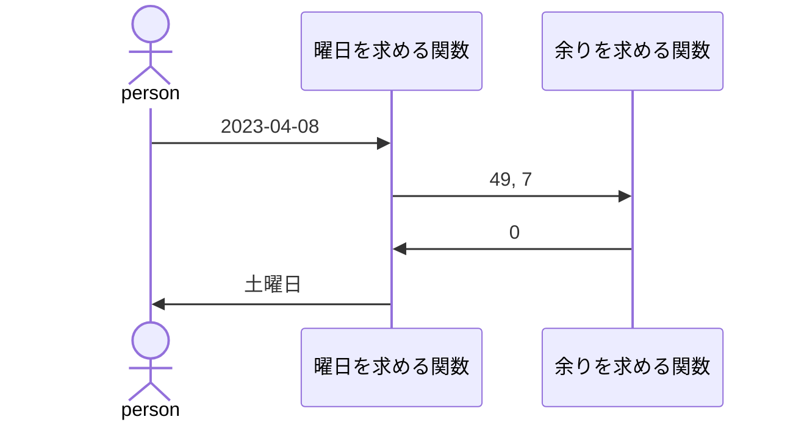
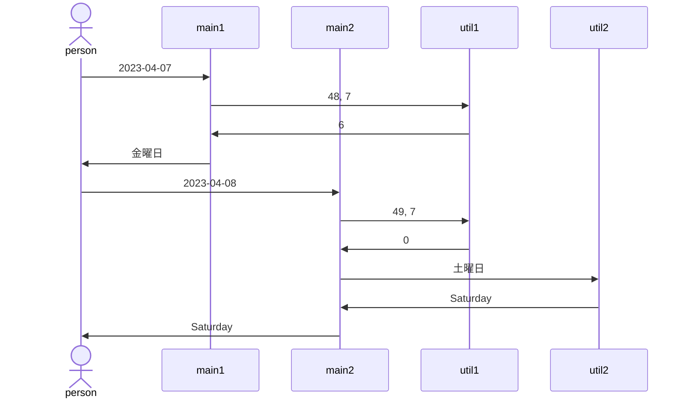

# この記事の流れ
1. この記事で述べることに関しての前提条件の提示
1. 単体テストの目的の確認
1. その目的を達成するためにどんなことを意識すれば良いのか筆者なりの考えの共有

# 前提条件
- 筆者はPython(pytest)の経験を元に記載しているので、部分的に言語依存の表記があるかもです
- 考え方なので正解はないと思っております、1つの意見として読んでいただければと思います

# 単体テストの目的

以下は、最近流行りのChatGPTくんに単体テストの目的を聞いた結果に筆者が一部編集したものです

> 単体テスト（Unit Testing）は、ソフトウェアの開発プロセスの中で、単一のコンポーネントやモジュール、関数などの個々の単位をテストする工程です。単体テストの目的は、以下の通りです。
<br>再利用性向上：単体テストを行うことによって、テストされたコードは再利用性が高くなります。既にテスト済みのコードは、他のプログラムで使用することができるため、再利用性の向上に繋がります。
<br>品質向上：単体テストは、開発者が自分の作成したコードの品質を確認するための手段です。テスト結果からバグを発見し、修正することができます。単体テストがしっかりと実施されることによって、バグの混入を未然に防ぐことができます。
<br>メンテナンス性向上：単体テストは、コンポーネント単位で行うため、メンテナンス性が向上します。修正すべき箇所が特定されるため、修正作業が容易になります。
<br>速やかなバグ発見：単体テストは、開発プロセスの初期段階から実施されるため、バグの早期発見に繋がります。早期発見により、修正作業が早期に行われるため、後の開発工程でのバグ混入を防止することができます。
<br>以上のように、単体テストはソフトウェア開発プロセスの重要な工程であり、品質向上や再利用性向上、メンテナンス性向上などの多くのメリットをもたらします。

# 上記の目的を達成するためにどのように考えて進めれば良いのか

結論から述べると、意識している2つのことは以下です
- inputに対してoutputは何かを明確にする
- 使用している自作の他関数は全てモック化する

それぞれの理由については以下です
- inputに対してoutputは何かを明確にする
    - 何を入れれば何が返ってくるかだけを担保できれば関数としての機能を果たせるため
    - 他関数のモックを正しく作成するため
- 使用している自作の他関数は全てモック化する
    - モック化しないと、どこの関数に問題があるのか切り分けがしにくいため
    - モック化しないと、他関数にバグがあっても呼び出し元の関数の影響でテストが通ってしまう可能性があるため

## 具体的に何をするのかシンプルなパターンで考えてみる

シンプルなパターンではどんなことをすれば良いかを知っていただければと思います

今回は曜日を求めるコードを単体テストする場合を想定して考えます


曜日を求める式は以下です(各変数に関しては今回は関係ないため説明は省略します)
```math
h = \left\{ d + \left\lfloor \frac{ 26 (m + 1) }{ 10 } \right\rfloor + Y + \left\lfloor \frac Y 4 \right\rfloor + \mathit \Gamma \right\} \mod 7 
```

この時、単体テストでは、曜日を求める関数関数と余りを求めるための関数に対して単体テストを実装する必要があると思います
それぞれの関数に関して以下のように考えます
- 曜日を求める関数実装時：
    - inputに対してoutputは何かを明確にする
        - input：日付(2023-04-08)
        - output：inputの日付の曜日(土曜日)
    - 使用している自作の他関数は全てモック化する
        - 余りを求める関数をモック化
- 余りを求める関数実装時：
    - inputに対してoutputは何かを明確にする
        - input：割られる数(49), 割る数(7)
        - output：余り(0)
    - 使用している自作の他関数は全てモック化する
        - 使用している他関数はなし

あとは、以下の流れでコードを書いていくのみです
1. inputの情報を作成
1. モック化が必要な部分はモック化
1. 作成したinputを使用してテスト対象の関数を実行
1. 以下によりテスト成功・失敗を判定
    - モック化している箇所を正しく呼び出せているか
    - テスト対象の関数からのoutputが想定通りか
1. テスト成功すればOK、失敗すればコードが間違っていないか確認

:::note info
**モック化している箇所を正しく呼び出せているか**

さらっと書きましたが、この観点でのテスト判定もしないと、関数を結合したときにバグが生じる可能性があるので、判定項目には必ず入れましょう！
:::

## なぜ必要なのか少し複雑なパターンで考えてみる

少し複雑なパターンでは、2つの考え方の必要性を知っていただければと思います

以下を例として考えます
例は曜日を求めるコード(日本語版・英語版)を単体テストする場合を想定しています



以下考え方の具体例とコード作成の流れは省略します
- inputに対してoutputは何かを明確にする
- 使用している自作の他関数は全てモック化する

### 「inputに対してoutputは何かを明確にする」の必要性

もう一度テストコード作成の手順を展開します

>1. inputの情報を作成
>1. モック化が必要な部分はモック化
>1. 作成したinputを使用してテスト対象の関数を実行
>1. 以下によりテスト成功・失敗を判定
>    - モック化している箇所を正しく呼び出せているか
>    - テスト対象の関数からのoutputが想定通りか
>1. テスト成功すればOK、失敗すればコードが間違っていないか確認

手順を見るだけで`inputに対してoutputは何かを明確にする`ことの必要性は感じると思いますので補足事項は特にありません
あとはinput, outputの関係のレパートリーを増やして、さまざまなパターンでテストが実施できるとより意味のある単体テストになります

### 「使用している自作の他関数は全てモック化する」の必要性

今回では以下の単体テストが作成されると思います
- main1
- main2
- util1
- util2

そして各関数に対してバグがあった場合のテスト成功・失敗は以下のようになります

1. 使用している自作の他関数は全てモック化する場合

|バグのある関数|main1のテスト|main2のテスト|util1のテスト|util2のテスト|
|---|---|---|---|---|
|main1|×|○|○|○|
|main2|○|×|○|○|
|util1|○|○|×|○|
|util21|○|○|○|×|


2. 使用している自作の他関数は全てモック化しない場合

|バグのある関数|main1のテスト|main2のテスト|util1のテスト|util2のテスト|
|---|---|---|---|---|
|main1|×|○|○|○|
|main2|○|×|○|○|
|util1|×|×|×|○|
|util21|○|×|○|×|

1のパターンはバグがあった場合、どの関数に問題があるかテストの状況から明らかですが、2のパターンはutilが失敗した場合、多くのテストが影響を受けており、問題のある関数の切り分けから必要です

このように、テストの失敗が何に起因するのかを明確にするために、`使用している自作の他関数は全てモック化する`ことが大切だと考えています

# 最後に

Qiita初投稿でした。
今後は、学んできた知識をどんどんアウトプットしていきたいと思っております！
文章・内容共にブラッシュアップしていきたいと思いますので、コメントあれば是非お願いします！

拙い文章でしたが、私の考えが少しでも伝われば幸いです。
最後まで読んでいただきありがとうございました！

